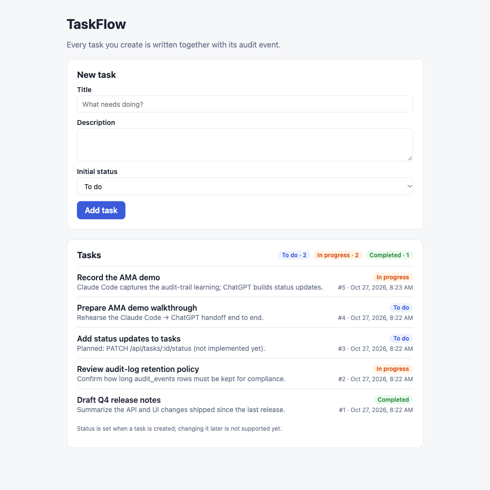

# TaskFlow

A deliberately small task manager: a Fastify + SQLite REST API and a React/Vite UI. It exists to
demonstrate [Salvor](https://github.com/SalvorLabs/Salvor) repo-owned engineering memory being handed
from one coding agent to another (Claude Code → ChatGPT via GitHub). The app itself is real: real
persistence, real transactions, real tests.



## What it does today

- `GET /api/tasks` — list tasks, newest first.
- `POST /api/tasks` — create a task (`title`, `description`, `status`) and return it with `201`.
- `GET /api/audit-events[?taskId=N]` — read-only view of the audit trail.
- Every successful create writes a `task.created` row to `audit_events` **in the same SQLite
  transaction** as the task. If the audit insert fails, the task is rolled back; a failed create never
  leaves a ghost audit event.
- The UI lists tasks with status badges and has a form to add one.

**Not implemented yet (planned):** `PATCH /api/tasks/:id/status` — changing an existing task's status.
The API currently answers `404` for it, and the UI shows status as read-only. See
[Planned: status updates](#planned-status-updates).

## Requirements

- Node.js 20+ (developed on 22) and npm 10
- No external services, accounts, or API keys

## Run it

```bash
npm install
npm run dev
```

- UI: <http://localhost:5173>
- API: <http://127.0.0.1:3001> (the UI proxies `/api` to it)

On first start the API creates `api/data/taskflow.db`, applies migrations, and seeds four sample tasks
(each with its own `task.created` audit row, actor `seed`). The database file is gitignored.

API only: `npm start`. Settings (all optional, read from the environment — see `.env.example`):

| Variable | Default | Meaning |
|---|---|---|
| `PORT` | `3001` | API port |
| `TASKFLOW_DB_PATH` | `api/data/taskflow.db` | SQLite file (`:memory:` for a throwaway DB) |
| `TASKFLOW_ACTOR` | `demo-operator` | Written to `audit_events.actor` (demo stand-in for auth) |
| `TASKFLOW_SEED` | `true` | Seed sample tasks into an empty DB |

## Test and build

```bash
npm test          # Vitest: shared, api, web projects
npm run build     # type-check shared + api, type-check + vite build web
npm run format    # prettier
```

The API tests use real in-memory SQLite, not mocks. The atomicity proof lives in
`api/test/taskRepository.test.ts` › **task creation audit atomicity**: it makes the real
`audit_events` (or `tasks`) insert fail with a SQLite `RAISE(ABORT)` trigger and asserts that neither
row persists. `api/test/app.test.ts` checks the same thing over HTTP (`500`, zero rows).

## Check the audit trail by hand

With the API running:

```bash
npm run verify:audit        # POSTs a task, prints its audit row via the API and sqlite3
```

Or with curl:

```bash
curl -s -X POST http://127.0.0.1:3001/api/tasks \
  -H 'content-type: application/json' \
  -d '{"title":"Check audit","description":"by hand","status":"todo"}'
# → 201 {"id":5,"title":"Check audit",...}

curl -s 'http://127.0.0.1:3001/api/audit-events?taskId=5'
# → [{"id":5,"action":"task.created","taskId":5,"actor":"demo-operator",
#     "createdAt":"…","metadata":{"requestId":"<uuid>","after":{"title":"Check audit",…}}}]

sqlite3 -header -column api/data/taskflow.db \
  "SELECT id, action, task_id, actor, created_at FROM audit_events ORDER BY id DESC LIMIT 5;"
```

## Data model

Defined in `api/src/db.ts` (migration `001_create_tasks_and_audit_events`; migrations are append-only).

| `tasks` | | `audit_events` | |
|---|---|---|---|
| `id` | integer PK | `id` | integer PK |
| `title` | 1–200 chars | `action` | e.g. `task.created` |
| `description` | text, default `''` | `task_id` | FK → `tasks.id` |
| `status` | `todo` \| `in_progress` \| `completed` | `actor` | non-empty |
| `created_at`, `updated_at` | ISO-8601 UTC | `created_at` | ISO-8601 UTC |
| | | `metadata` | JSON: `requestId`, `after` snapshot |

## Planned: status updates

`PATCH /api/tasks/:id/status` with body `{"status": "in_progress" | "completed" | "todo"}` should change
an existing task's status and update `updated_at`. It is intentionally left unimplemented here; it is the
follow-up feature for the cross-vendor demo (see `docs/AMA_DEMO_SCRIPT.md`).

## Layout

```
api/      Fastify API — src/app.ts (routes), src/taskRepository.ts (task + audit transaction), src/db.ts
web/      React UI — src/App.tsx, src/taskView.ts (pure, unit-tested UI logic)
shared/   zod schemas + types used by both
scripts/  verify-audit.sh, reset-demo-db.sh
docs/     AMA demo script, screenshots
.salvor/  Salvor engineering memory (see below)
```

## Salvor engineering memory

This repo has [Salvor](https://github.com/SalvorLabs/Salvor) installed (Core Protocol, strict defaults
off). Agents start from `CLAUDE.md` (Claude Code) or `AGENTS.md` / `GEMINI.md`, which route to
`RULES.md` and the `.salvor/` brain. The repo runs `AGENT_CAPTURE = provisional`: agents may record
domain learnings without a per-item prompt, but those land as `Review: unreviewed` and are treated as
hypotheses until a human ratifies them.
